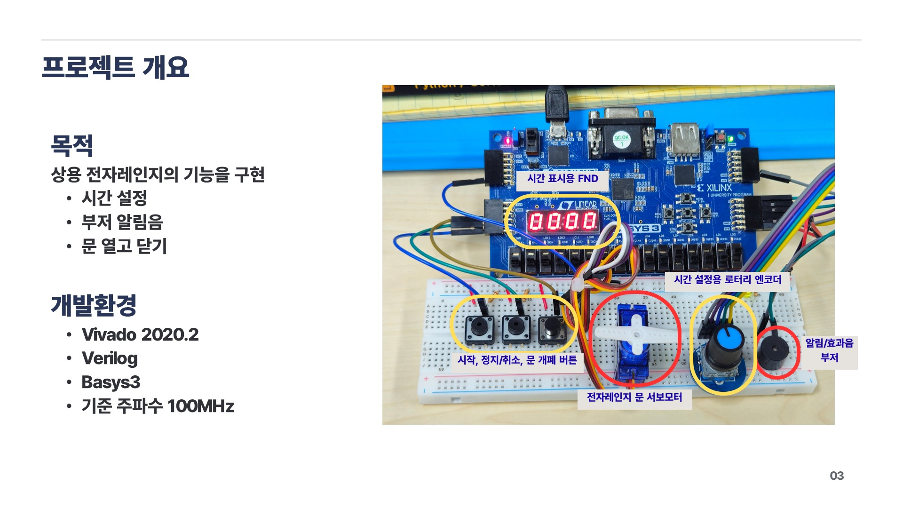
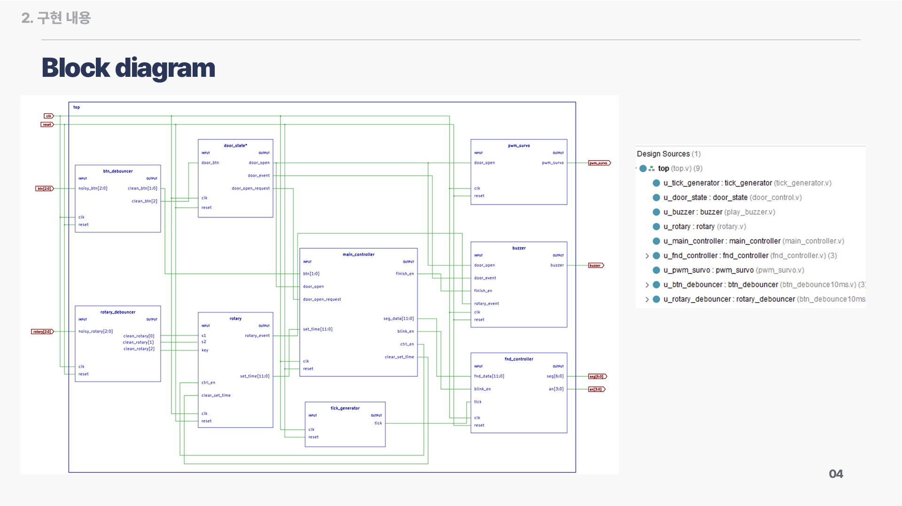
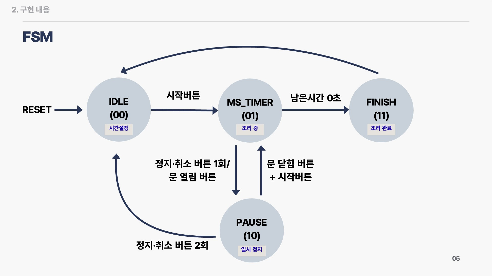

# FPGA 전자레인지 제어 시스템

Basys3 보드와 Verilog HDL로 전자레인지의 시간 설정, 카운트다운, 문 개폐, 알림음을 구현한 프로젝트입니다. 로터리 엔코더로 시간을 설정하고, FSM으로 시작·일시정지·취소·완료 동작을 제어합니다.



**[동작 영상 보기](https://youtu.be/MlRTrFV1iwM)** · **[발표 자료 보기](images/)**

## 개발 환경

| 항목 | 구성 |
| --- | --- |
| FPGA 보드 | Digilent Basys3 |
| 개발 도구 | Vivado 2020.2 |
| 언어 / 기준 클럭 | Verilog HDL / 100 MHz |
| 입력 | 시작·정지·문 개폐 버튼, 로터리 엔코더 및 내장 버튼 |
| 출력 | 4자리 7세그먼트(FND), 서보모터 PWM, 부저 |

## 주요 기능 및 조작 방법

| 입력 | 동작 |
| --- | --- |
| 로터리 CW / CCW | 대기 상태에서 설정 시간을 10초 단위로 증가 / 감소 |
| 로터리 내장 버튼 | 대기 상태에서 30초 추가 |
| 시작 버튼 `btn[0]` | 문이 닫혀 있고 설정 시간이 0이 아니면 시작, 일시정지 상태에서는 재개 |
| 정지 버튼 `btn[1]` | 동작 중에는 일시정지, 일시정지 상태에서 다시 누르면 취소 및 설정 시간 초기화 |
| 문 개폐 버튼 `btn[2]` | 누를 때마다 문 상태 전환, 동작 중 문을 열면 일시정지 |
| 리셋 `reset` | 제어 상태와 설정 시간 초기화, 문 상태를 닫힘으로 설정 |

- 설정 범위는 **0초~59분 59초**이며, FND에 분·초를 네 자리로 표시합니다.
- 문을 닫은 뒤에도 일시정지를 유지하며, 시작 버튼을 눌러야 재개합니다.
- 완료 시 FND를 0.5초 간격으로 점멸하고 부저를 3회 울린 뒤 대기 상태로 돌아갑니다.
- 로터리 조작음과 문 열기·닫기 효과음을 출력합니다. 부저 출력 우선순위는 완료음 → 문 개폐음 → 로터리 조작음입니다.

일반 버튼과 리셋은 Active-High, 로터리 내장 버튼은 Active-Low입니다. `rotary[0]`은 S1, `rotary[1]`은 S2, `rotary[2]`는 내장 버튼에 연결합니다.

## 제어 구조





`door_state`가 문 상태를 관리하고, 같은 `door_open` 신호를 제어 FSM·서보 PWM·부저에 전달합니다. 문 열기 요청인 `door_open_request`도 FSM에 전달해 문 상태가 갱신되는 클럭에서 시작을 막거나 일시정지하도록 구성했습니다.

| 소스 파일 | 역할 |
| --- | --- |
| [top.v](sources/top.v) | 전체 모듈 연결 및 입출력 구성 |
| [main_controller.v](sources/main_controller.v) | 4개 상태의 FSM, 카운트다운, 완료 표시 제어 |
| [rotary.v](sources/rotary.v) | 엔코더 상태 변화 검출, 설정 시간 및 조작 이벤트 생성 |
| [btn_debounce10ms.v](sources/btn_debounce10ms.v) | 2단 플립플롭 동기화 및 입력 디바운싱 |
| [door_control.v](sources/door_control.v) | `door_state` 모듈: 문 상태와 개폐 이벤트 관리 |
| [fnd_controller.v](sources/fnd_controller.v) | 분·초의 십진수 변환, 자리 선택 및 점멸 출력 |
| [tick_generator.v](sources/tick_generator.v) | FND 자리 선택용 1 ms tick 생성 |
| [pwm_survo.v](sources/pwm_survo.v) | 문 상태에 따른 50 Hz 서보 PWM 생성 |
| [play_buzzer.v](sources/play_buzzer.v) | `buzzer` 모듈: 조작음·문 개폐음·완료음 생성 |

100 MHz 기준으로 일반 버튼과 로터리 내장 버튼은 약 10 ms, 로터리 S1·S2는 약 2 ms 동안 입력이 유지되면 반영합니다. FND의 1 ms tick과 별도로, 카운트다운은 `main_controller` 내부 카운터에서 1초를 생성합니다. 서보 PWM은 주기 20 ms이며, 문 열림 시 High 펄스 1 ms, 닫힘 시 2 ms를 출력합니다.

## 저장소 구성

```text
FPGA_Microwave/
├── sources/                       # 합성용 Verilog 소스 (최상위: top)
├── sim/                           # 통합 테스트벤치
│   └── tb_microwave.v              # 시뮬레이션 최상위: tb_top
├── constrs/                       # 핀 배치 및 클럭 제약
│   └── Basys3-Master_orginal.xdc
├── images/                        # 발표 슬라이드 이미지
├── video/                         # 동작 영상
└── README.md
```

## Vivado 프로젝트 설정 및 실행

1. Vivado 프로젝트를 만들고 `sources/*.v`를 Design Sources에 추가합니다.
2. `sim/tb_microwave.v`를 Simulation Sources에 추가합니다.
3. [constrs/Basys3-Master_orginal.xdc](constrs/Basys3-Master_orginal.xdc)를 Constraints에 추가합니다. 파일에는 100 MHz 클럭과 `top` 입출력의 핀 배치가 정의되어 있습니다.
4. 합성용 최상위 모듈은 `top`, 시뮬레이션 최상위 모듈은 `tb_top`으로 지정합니다.
5. **Run Simulation → Run Behavioral Simulation**을 실행한 뒤 **Run All**로 테스트벤치의 `$finish`까지 진행합니다.

보드 실행 시에는 Basys3를 대상으로 합성·구현 후 비트스트림을 생성하고, Hardware Manager에서 보드에 다운로드합니다. 외부 버튼·로터리 엔코더·서보모터·부저는 XDC의 핀 배치에 맞춰 연결합니다. 리셋은 보드의 SW15에 할당되어 있습니다.

테스트벤치에는 30초 설정 → 시작 → 일시정지·재개 → 문 열기 → 열린 상태에서 시작 시도 → 문 닫기 → 재개 → 취소 순서의 입력이 작성되어 있습니다. `$monitor`로 FSM 상태, 설정 시간, 문 상태를 출력합니다.

현재 테스트벤치는 결과를 자동 판정하는 assertion을 포함하지 않으며, 로터리 회전과 시간 만료 후 완료 동작은 해당 시나리오에 포함되어 있지 않습니다. 본 README 작성 시 시뮬레이션을 새로 실행하지 않았습니다.

Vivado 프로젝트 파일은 포함되어 있지 않으므로 위 소스와 XDC로 프로젝트를 구성합니다. 서보의 실제 회전 각도는 모터 사양과 장착 상태에 따라 확인이 필요합니다.
